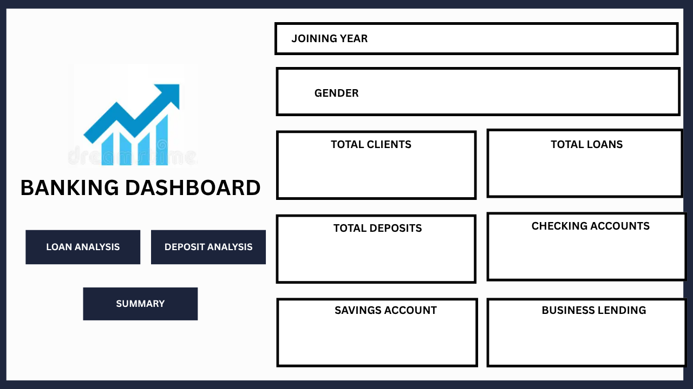
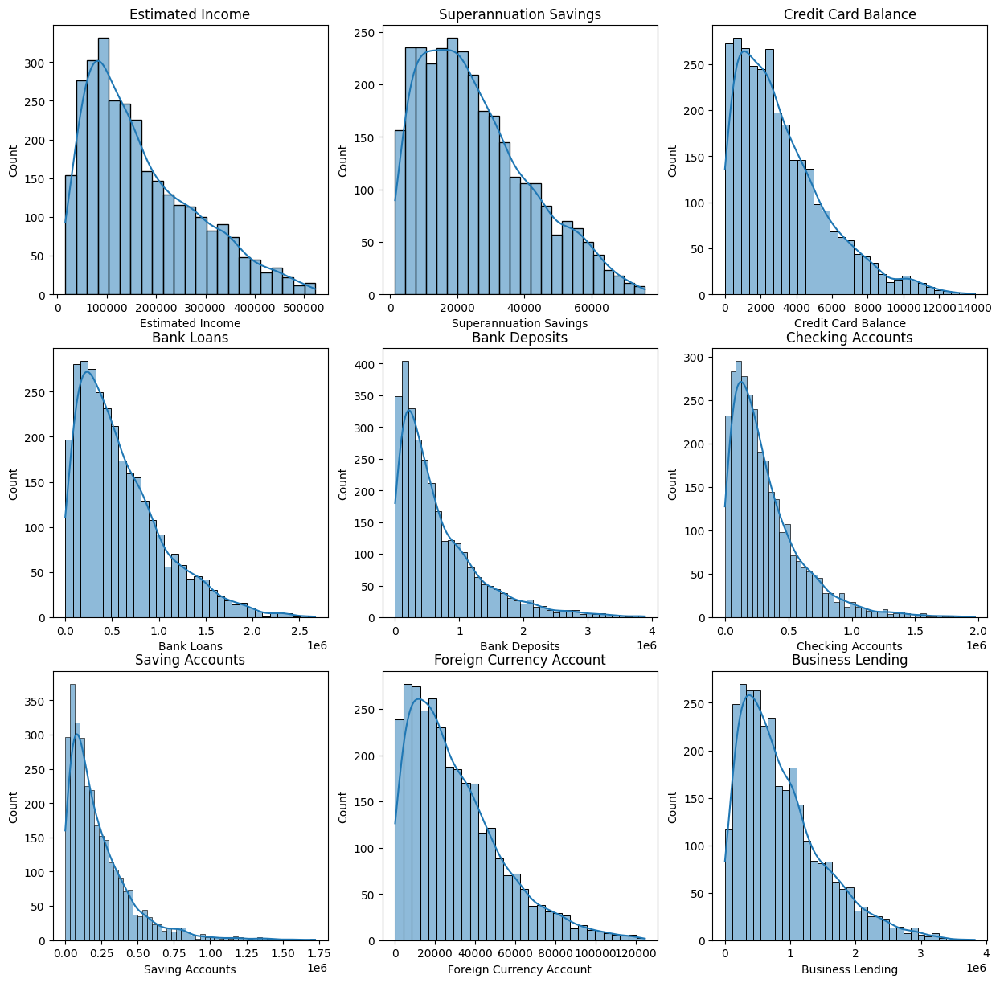
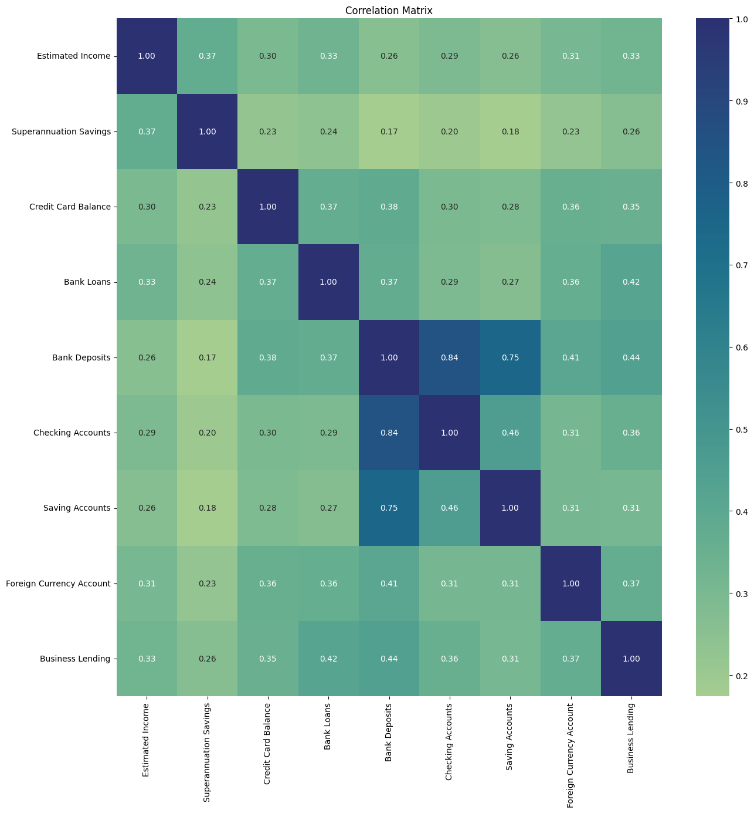

# 🏦 Banking Customer Analytics & Business Intelligence Platform

[](sql/)
[](BANKING%20DASHBOARD.pbix)
[](BANKING%20-%20EDA%20CASE%20STUDY.ipynb)
[](BANKING%20-%20EDA%20CASE%20STUDY.ipynb)
[](LICENSE)
[](https://github.com/Altaire3306)

An end-to-end financial analytics and business intelligence solution evaluating retail banking customer behavior, credit exposure, wealth segmentation, lending portfolios, and marketing conversion dynamics across 3,000 active retail accounts.

---

## 📌 Executive Summary

Modern retail banks operate across diverse product verticals—from revolving credit facilities and mortgage lending to superannuation and term deposits. Maximizing customer lifetime value (CLV) while mitigating credit risk requires granular visibility into customer demographics, income-to-debt ratios, risk weightings, and campaign responsiveness.

This project delivers a multi-tiered analytics framework:
1. **Relational Database Modeling & DDL Schema** with performance indexes for enterprise query execution.
2. **Deep-Dive SQL Analytics Suite** (8 specialized modules, 70+ analytical queries, CTEs, and advanced window functions).
3. **Exploratory Data Analysis (EDA)** in Python evaluating skewness, distributions, outlier patterns, and multi-variable correlations.
4. **Executive Power BI Dashboard** providing dynamic slice-and-dice intelligence on customer cohorts, lending performance, deposit campaign conversions, and balance sheet exposure.

---

## 🏗️ System Architecture & Analytical Pipeline

```
+-----------------------------------------------------------------------------------+
|                                Raw Banking Data                                   |
|                (3,000 Retail Banking Customer Records: CSV / Excel)               |
+-----------------------------------------------------------------------------------+
                                          |
                     +--------------------+--------------------+
                     |                                         |
                     v                                         v
   +------------------------------------+    +------------------------------------+
   |         SQL Analytics Engine       |    |         Python EDA Engine          |
   |   - MySQL DDL Schema & Indexes     |    |   - Pandas Data Wrangling          |
   |   - Demographics & Income Modules  |    |   - Matplotlib & Seaborn Plots     |
   |   - Credit, Loan & Wealth Metrics  |    |   - Statistical Distribution Tests |
   |   - Window Functions & Percentiles |    |   - Correlation Heatmaps           |
   +------------------------------------+    +------------------------------------+
                     |                                         |
                     +--------------------+--------------------+
                                          |
                                          v
   +--------------------------------------------------------------------------------+
   |                     Power BI Business Intelligence Dashboard                   |
   |   - Dimensional Data Model with Star Schema Optimization                       |
   |   - DAX Measures: Total Assets, Risk Ratios, Conversion %                      |
   |   - Interactive Views: Executive Overview, Loan Portfolio, Deposit Conversion  |
   +--------------------------------------------------------------------------------+
```

---

## 📂 Repository Structure

```
.
├── assets/
│   ├── dashboard_kpi_overview.png       # Power BI executive overview canvas
│   ├── dashboard_loan_analysis.png      # Power BI lending portfolio analysis
│   ├── dashboard_deposit_analysis.png   # Power BI deposit campaign tracking
│   ├── dashboard_summary_view.png       # Power BI executive summary view
│   ├── eda_numerical_distributions.png  # Python EDA histogram & KDE plots
│   └── eda_correlation_heatmap.png      # Feature correlation matrix
├── sql/
│   ├── schema.sql                       # DDL schema definition & performance indexes
│   ├── customer_analysis.sql            # Demographics, age cohorts & loyalty breakdown
│   ├── income_analysis.sql              # Income brackets, occupation & salary insights
│   ├── credit_card_analysis.sql         # Revolving credit, top balances & burden metrics
│   ├── loan_analysis.sql                # Personal & business loan distribution
│   ├── risk_analysis.sql                # Risk weighting & credit exposure profiling
│   ├── wealth_analysis.sql              # Total net worth, HNWI & balance sheet assets
│   ├── deposit_analysis.sql             # Term deposit campaign conversion analytics
│   └── window_functions.sql             # Ranking, running totals & cohort percentiles
├── BANKING - EDA CASE STUDY.ipynb       # Python EDA Jupyter Notebook
├── BANKING DASHBOARD.pbix               # Interactive Power BI Dashboard
├── Banking.csv                          # Primary dataset (3,000 records)
├── Banking.xlsx                         # Multi-tab workbook dataset
├── .gitignore                           # Git ignore rules for clean dev environment
├── LICENSE                              # MIT License
└── README.md                            # Comprehensive project documentation
```

---

## 📖 Data Dictionary & Schema Definition

The primary `banking` relation contains **3,000 rows** across **25 attributes**:

| Column Name | Data Type | Description | Analytical Significance |
|:---|:---|:---|:---|
| `Client ID` | `VARCHAR(32)` | Unique customer identification code | Primary Key |
| `Name` | `VARCHAR(128)` | Full customer name | Customer identification |
| `Age` | `INT` | Customer age in years (18 - 85) | Demographic cohort segmentation |
| `Location ID` | `INT` | Geographic branch or territory code | Regional clustering |
| `Joined Bank` | `VARCHAR(32)` | Date customer opened initial account | Customer tenure & vintage analysis |
| `Banking Contact` | `VARCHAR(128)` | Assigned relationship manager / contact | Staff performance & account allocation |
| `Nationality` | `VARCHAR(64)` | Customer citizenship / nationality | Global customer base segmentation |
| `Occupation` | `VARCHAR(128)` | Job role / profession | Income & credit risk determinant |
| `Fee Structure` | `VARCHAR(32)` | Account maintenance tier (`Low`, `Mid`, `High`)| Revenue driver per client account |
| `Loyalty Classification` | `VARCHAR(32)` | Loyalty tier (`Jade`, `Silver`, `Gold`, `Platinum`) | Customer value tiering |
| `Estimated Income` | `DECIMAL(15,2)`| Annual gross income estimate | Debt serviceability benchmark |
| `Superannuation Savings` | `DECIMAL(15,2)`| Pension / retirement accumulated funds | Long-term asset holding |
| `Amount of Credit Cards` | `INT` | Number of active revolving credit cards | Credit capacity & risk exposure |
| `Credit Card Balance` | `DECIMAL(15,2)`| Current revolving outstanding balance | Short-term debt obligation |
| `Bank Loans` | `DECIMAL(15,2)`| Outstanding retail / personal / auto loans | Retail lending exposure |
| `Bank Deposits` | `DECIMAL(15,2)`| Total liquid deposits across terms | Core liability funding base |
| `Checking Accounts` | `DECIMAL(15,2)`| Transactional checking account balances | Demand deposit liquidity |
| `Saving Accounts` | `DECIMAL(15,2)`| High-yield savings balances | Retail savings retention |
| `Foreign Currency Account`| `DECIMAL(15,2)`| Balances held in FX accounts | Cross-border wealth indicator |
| `Business Lending` | `DECIMAL(15,2)`| Commercial lending / credit line debt | Commercial credit risk |
| `Properties Owned` | `INT` | Count of real estate properties owned | Tangible collateral proxy |
| `Risk Weighting` | `INT` | Risk score category (1 = Low to 5 = High) | Basel compliance / portfolio risk |
| `BRId` | `INT` | Branch identifier key | Physical branch mapping |
| `GenderId` | `INT` | Gender identifier (1 = Male, 2 = Female) | Demographic classification |
| `IAId` | `INT` | Investment advisor identifier | Wealth advisory tracking |

---

## 🔍 SQL Analytical Modules Breakdown

The project contains 8 targeted SQL analytical modules answering strategic business questions:

### 1. Customer Demographics (`sql/customer_analysis.sql`)
- Evaluates total customer count, average customer age, age extremes, and geographic/nationality concentration.
- Breaks down customer distributions across 4 loyalty tiers: **Jade**, **Silver**, **Gold**, and **Platinum**.

### 2. Income & Earnings (`sql/income_analysis.sql`)
- Calculates average and median estimated income across professions and national origins.
- Identifies high-earning segments (`Estimated Income > $150,000`) and evaluates superannuation contribution rates.

### 3. Credit Card Analysis (`sql/credit_card_analysis.sql`)
- Analyzes total and average revolving credit balances ($4.4M+ total credit exposure).
- Identifies clients running balances above the portfolio average ($1,478) and evaluates debt-to-income warning signs.

```sql
-- High-Debt to High-Income Outlier Identification
SELECT
    `Client ID`,
    `Name`,
    `Occupation`,
    `Estimated Income`,
    `Credit Card Balance`
FROM banking
WHERE `Estimated Income` > (SELECT AVG(`Estimated Income`) FROM banking)
  AND `Credit Card Balance` > (SELECT AVG(`Credit Card Balance`) FROM banking)
ORDER BY `Credit Card Balance` DESC;
```

### 4. Loan & Lending Portfolio (`sql/loan_analysis.sql`)
- Aggregates bank loan commitments versus commercial business lending lines.
- Computes loan-to-deposit ratios (LDR) across customer tiers to evaluate liquidity resilience.

### 5. Credit Risk & Weighting (`sql/risk_analysis.sql`)
- Segregates customers by `Risk Weighting` (1 through 5).
- Detects concentration risks where high risk-weighted clients hold disproportionately large loan balances.

### 6. Wealth & High Net-Worth Individuals (`sql/wealth_analysis.sql`)
- Computes aggregate client net worth across checking, savings, deposits, foreign currency, and retirement accounts.
- Identifies top 100 Ultra High Net-Worth Individuals (UHNWI) for private wealth advisory targeting.

### 7. Window Functions & Cohort Percentiles (`sql/window_functions.sql`)
- Employs `RANK()`, `DENSE_RANK()`, `ROW_NUMBER()`, and `NTILE(4)` quartiles to segment clients across balance sheets.
- Calculates cumulative running deposits and moving balance averages per occupation.

```sql
-- Partitioned Deposit Ranking per Profession
SELECT
    `Client ID`,
    `Name`,
    `Occupation`,
    `Bank Deposits`,
    RANK() OVER (
        PARTITION BY `Occupation`
        ORDER BY `Bank Deposits` DESC
    ) AS Occupation_Deposit_Rank
FROM banking;
```

---

## 📊 Power BI Business Intelligence Dashboard

The companion **Power BI report (`BANKING DASHBOARD.pbix`)** delivers dynamic executive dashboards:

| Dashboard View | Primary Metrics & Visualizations | Strategic Value |
|:---|:---|:---|
| **Executive Overview** | Total Clients, Deposits, Loans, Checking, Business Lending | High-level C-Suite KPI tracking |
| **Lending Portfolio** | Loan volume by Age, Property Count, Risk Weighting | Credit risk monitoring & underwriting |
| **Deposit Campaigns** | Conversion rate by Contact Type, Education, Marital Status | Marketing spend optimization |
| **Summary & Segmentation** | Loyalty Tier breakdown, Account Balance distribution | Retention & VIP wealth management |

### Dashboard Interface Architecture

*Figure 1: Executive KPI overview canvas with dynamic cross-filtering by joining year, gender, and branch.*

---

## 🐍 Python Exploratory Data Analysis (EDA)

The Jupyter Notebook (`BANKING - EDA CASE STUDY.ipynb`) provides statistical validation:
- **Missing Value & Integrity Audit**: Zero missing values detected across the 3,000 observations.
- **Skewness & Kurtosis Evaluation**: Identified right-skewed distributions in `Credit Card Balance` and `Business Lending`.
- **Bivariate & Multivariate Correlation**: Mapped relationships between income, savings accumulation, and loan exposure.

### Key Visualizations

*Figure 2: Probability density and histogram distributions across numerical features.*


*Figure 3: Pearson correlation heatmap revealing feature co-dependencies across financial metrics.*

---

## 💡 Strategic Business Recommendations

1. **Revolving Credit Risk Containment**: Establish automated balance alerts for customers with credit card balances exceeding $4,000 who maintain low liquid deposit ratios.
2. **Private Banking Upsell**: Target the top 15% `Jade` and `Platinum` clients with dedicated wealth managers (`IAId`) to cross-sell superannuation and foreign currency products.
3. **Optimized Campaign Conversion**: Term deposit conversion peaked among digitally contacted customers in Mid-to-High income brackets; reallocate outbound marketing budgets from cold calling to tailored digital channels.
4. **Loan-to-Deposit Balance**: Monitor customers in Risk Weighting categories 4 and 5 who hold business lending lines over $1.5M, ensuring adequate real estate collateral backing.

---

## 🚀 Setup & Execution Guide

### 1. Database Ingestion (MySQL / PostgreSQL)
```bash
# Clone the repository
git clone https://github.com/Altaire3306/Banking-Customer-Analytics.git
cd Banking-Customer-Analytics

# Initialize database schema
mysql -u root -p -e "CREATE DATABASE banking_analytics;"
mysql -u root -p banking_analytics < sql/schema.sql

# Load dataset (using MySQL Local Infile or Import Wizard)
mysql -u root -p --local-infile=1 banking_analytics -e "LOAD DATA LOCAL INFILE 'Banking.csv' INTO TABLE banking FIELDS TERMINATED BY ',' ENCLOSED BY '"' LINES TERMINATED BY '
' IGNORE 1 LINES;"
```

### 2. Python EDA Setup
```bash
# Set up virtual environment
python -m venv venv
source venv/bin/activate  # On Windows: venv\Scripts\activate

# Install dependencies
pip install pandas numpy matplotlib seaborn jupyter

# Launch notebook
jupyter notebook "BANKING - EDA CASE STUDY.ipynb"
```

### 3. Power BI Dashboard
1. Launch **Power BI Desktop**.
2. Open `BANKING DASHBOARD.pbix`.
3. If prompted to refresh data sources, select `Data Source Settings` and point `Banking.csv` / `Banking.xlsx` to your local clone path.

---

## 👤 Author & Developer

**Ronit Raj**
- **GitHub**: [@Altaire3306](https://github.com/Altaire3306)
- **Email**: [rrronitaj3306@gmail.com](mailto:rrronitaj3306@gmail.com)

---

## 📄 License

This project is licensed under the MIT License - see the [LICENSE](LICENSE) file for details.
